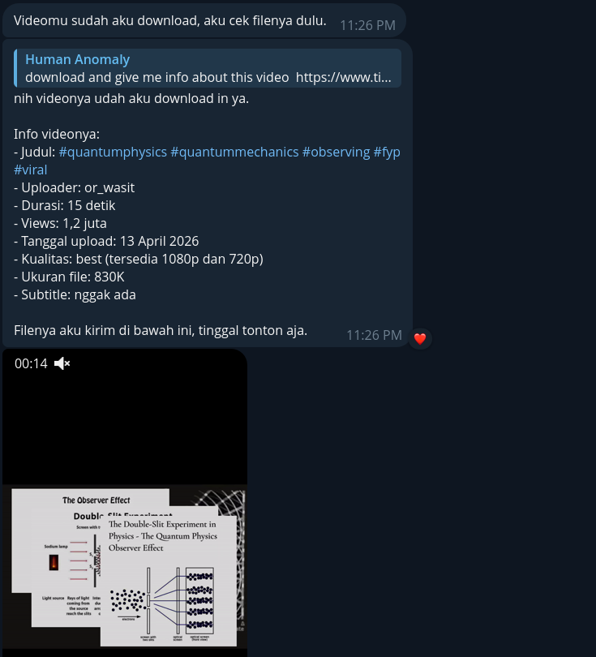

<p align="center">
  <a href="assets/banner.png">
    
  </a>
</p>

<p align="center">
  
  
  
  
</p>

<p align="center">
  <strong>An MCP server that lets AI agents inspect, download, and convert video and audio using yt-dlp and FFmpeg through natural language instructions.</strong>
</p>

## Example

Send a link, get the file. Or type `/ytdlp-mcp` in OpenCode, Gemini CLI, or Claude Code:



## Install

```bash
git clone https://github.com/fanyzp/ytdlp-mcp.git && cd ytdlp-mcp && npm run setup
```

Requires `yt-dlp`, `ffmpeg`, Node 18. Or copy [PROMPT.md](PROMPT.md) into any AI agent and let it install for you.

## Tools

| Tool            | What it does                                                      |
| --------------- | ----------------------------------------------------------------- |
| `probe`         | Read title, duration, uploader, views, thumbnail, and description |
| `formats`       | List available media formats, quality, and estimated sizes        |
| `supported`     | Check whether a URL matches a locally installed yt-dlp extractor  |
| `inspect`       | Recommend a download action, quality, and available resolutions   |
| `get_video`     | Download video, default output is MP4                             |
| `get_audio`     | Extract audio as Opus, MP3, or M4A                                |
| `get_subtitles` | Download manual or auto-generated subtitles as VTT                |
| `advise`        | Answer yt-dlp configuration questions                             |
| `queue`         | Preview a batch of URLs and per-item download plans               |
| `fetch_all`     | Download a batch of URLs with optional delays                     |
| `watch`         | List entries from a playlist or channel without downloading       |
| `search`        | Search YouTube or SoundCloud and return compact metadata          |
| `convert`       | Re-encode a local video using FFmpeg presets                      |

### Search providers

The `search` tool uses yt-dlp search extractor prefixes. YouTube (`ytsearch`) and SoundCloud (`scsearch`) were verified against the installed yt-dlp build. Other installed extractors include search-related entries, but not all provide a supported search prefix, so they are not exposed as providers unless the prefix works in a real query. Search results return metadata only and are limited to 1-50 items.

| Provider     | yt-dlp prefix |
| ------------ | ------------- |
| `youtube`    | `ytsearch`    |
| `soundcloud` | `scsearch`    |

## Env

| Variable                   | Default                 |
| -------------------------- | ----------------------- |
| `YTDLP_DOWNLOAD_DIR`       | `~/Downloads/ytdlp-mcp` |
| `YTDLP_COOKIES_FILE`       | empty                   |
| `YTDLP_BIN` / `FFMPEG_BIN` | `yt-dlp` / `ffmpeg`     |

## License

MIT: [LICENSE](LICENSE)
